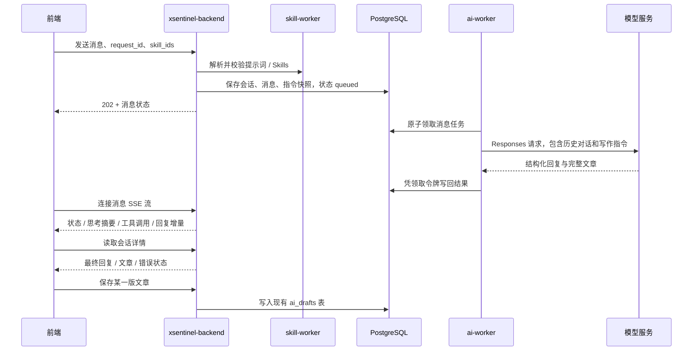

# 智能体对话：文章创作首版

入口为控制台「创作与发布 → 智能体对话」（`/agent-chat`）。支持持久化会话、生成文章、多轮修改，以及把某一版文章保存到文章管理。

## 使用

1. 在「数据源 → AI」配置支持 OpenAI Responses 协议的模型，并在 AI 创作设置中启用 AI。
2. 在「提示词管理」添加自定义提示词或导入 GitHub Skills。
3. 新建对话，输入主题、素材和要求。输入 `@` 或点击输入框下方的关联按钮，搜索并选择提示词和 Skills，候选项显示类型。使用方向键选择、Enter 确认、Esc 关闭；发送使用按钮或 Ctrl / Cmd + Enter。
4. 所选内容显示为可移除的标签，默认沿用到后续消息。每次发送时，后端重新校验有效性，并保存当时的名称、版本和完整指令快照；已发送的消息不随提示词编辑而改变。
5. 生成结束后继续描述修改要求。文章卡片提供「保存到文章管理」，同一条回复重复保存不会新增文章；保存不同回复会保留不同文章版本。

未选择提示词也可以对话。首版支持文字写作指导和导入 Skill 的已编译指令，不执行 Skill 脚本、不联网研究、不生成图片、不自动发布。

## 服务边界



后端是唯一的前端对话接口，负责鉴权、会话归属、提示词关联、任务提交、取消/重试和文章保存。`ai-worker` 负责读取 AI 数据源凭据、上下文拼装、模型通信及结果校验。

本版通过 PostgreSQL 持久化任务异步调用 `ai-worker`，沿用现有队列部署方式；没有新增 ai-worker 业务 HTTP 端口。`8202` 仍只提供监控指标。对话任务与已有 AI 生成任务共享单进程并发额度，避免两条队列分别放大模型并发。

后续可以让具体工具归属各业务微服务，以服务认证保护内部接口，由后端负责权限校验和编排。首版未实现模型工具调用循环，也不把文章保存交给模型自行决定。

## API 契约

以下路径均以 `/api/v1/agent-chat` 开头，并使用现有管理员登录鉴权；只有会话创建者可以读取或操作该会话。

| 方法 | 路径 | 用途 |
| --- | --- | --- |
| GET | `/conversations?page=1&page_size=30` | 分页读取自己的会话 |
| POST | `/conversations` | 创建会话 |
| GET | `/conversations/{id}` | 读取会话与消息状态 |
| POST | `/conversations/{id}/messages` | 提交消息，返回 202 |
| GET | `/conversations/{id}/messages/{turn_id}/stream` | Flux 风格 SSE 流，转发生成状态和增量事件 |
| POST | `/conversations/{id}/messages/{turn_id}/cancel` | 取消排队或生成中的消息 |
| POST | `/conversations/{id}/messages/{turn_id}/retry` | 重试最后一条失败或取消的消息 |
| POST | `/conversations/{id}/messages/{turn_id}/article` | 保存文章，返回字符串类型的 `article_id` |

发送请求示例：

```json
{
  "request_id": "e150da15-3321-45bd-817e-daa4a7cae801",
  "content": "写一篇面向职场新人的 AI 工作指南，先列出大纲。",
  "skill_ids": [12, 34]
}
```

`skill_ids` 同时承载提示词与 Skills 的 ID，按选择顺序应用。后端从 skill-worker 获取指令，前端不能提交自定义 system 指令冒充已有资源。相同会话内重发同一 `request_id` 和相同内容会返回原消息；改变内容或关联项则返回 409。

消息流使用 `text/event-stream`，事件数据保持小而稳定的业务协议：

| `type` | 用途 |
| --- | --- |
| `status` | `connecting`、`preparing`、`thinking`、`finalizing` 等阶段和可读状态 |
| `reasoning` | 模型返回的 reasoning summary 增量 |
| `tool` | 工具调用的开始和参数增量；当前版本只展示，不执行工具 |
| `output` | 回复 JSON 增量；前端实时预览回复与文章，最终正文从会话详情读取 |
| `done` / `error` | 生成完成或失败，随后读取最终会话详情 |

这个协议对应 OpenAI Responses 的 `response.*` 流事件，命名和生命周期参考 Codex 的事件分层；Backend 负责鉴权、事件过滤和 Redis Stream 转发，前端不直接连接模型服务。

模型 Responses 的 `output_text` 内容使用以下业务结构，通过 `AgentResult` 生成的严格 JSON Schema 约束。这两个字段是 Auto-X 的对话业务约定，不是 OpenAI 响应信封的顶层字段：

```json
{
  "reply": "已按照你的要求修改开头。",
  "article": {
    "title": "文章标题",
    "excerpt": "文章摘要",
    "content": "完整文章正文"
  }
}
```

澄清需求或纯讨论时 `article` 为 `null`。拒绝、不完整响应和无效 JSON 均作为失败处理，不保存半篇文章。界面以安全文本显示正文，不执行模型生成的 HTML。

## 可靠性与范围

- 每个会话同时只允许一条排队或运行中的消息，数据库部分唯一索引作最终保护。
- Worker 原子领取任务，以领取令牌和租约限制结果写回；取消或租约过期后的旧结果无法覆盖重试结果。取消是逻辑取消，已经发到模型服务的请求可能仍会消耗额度。
- Worker 退出会把尚未完成的任务重新排队；异常退出留下的运行任务在租约过期后标记失败，可手动重试。模型服务请求不承诺恰好一次计费。
- 重试保留原消息的提示词 / Skill 快照，采用当前生成长度、超时等设置，以及执行时的 AI 数据源配置。
- 每条用户消息最多 20,000 字符，每次最多关联 20 项，关联指令总量最多 160,000 字符；每个会话最多 100 条用户消息。
- 模型上下文包含最近至多 12 轮成功对话，按 120,000 字符预算保留完整轮次；必要时额外附加最近一版文章，避免长时间讨论后丢失编辑对象。更早的讨论仍保存在界面，但不保证进入模型上下文。
- 前端通过 SSE 接收运行中的状态、模型 reasoning summary、工具调用事件和回复增量，实时预览回复与文章并显示本次生成耗时；连接中断时回退到会话详情刷新。
- SSE 事件只转发模型明确返回的 reasoning summary，不展示隐藏的内部思维链。当前文章助手没有配置可执行工具；若上游返回工具事件，界面会按工具阶段展示名称和参数生成状态，执行能力仍需后续接入具体微服务。
- 会话按创建者隔离。保存到文章管理后，沿用现有文章管理的管理员访问规则。

## 升级

新增 Alembic 迁移 `0040_agent_chat`，创建 `agent_conversations` 与 `agent_turns`。按当前环境的升级流程先运行迁移，再更新 `backend`、`ai-worker` 与 `frontend`。不需要新增服务、端口或环境变量；skill-worker 继续提供现有解析接口。

本地开发环境的迁移命令（在 `backend/` 中，使用该环境的数据库配置）：

```bash
alembic upgrade head
```

不要只更新前端：未迁移或未更新的 worker 无法处理新对话任务。

实现入口：`backend/app/api/routes/agent_chat.py`、`backend/app/services/agent_chat_worker.py`、`backend/app/services/agent_provider.py`、`frontend/src/views/AgentChatView.vue`。

## 2026-10-22 部署记录

文章对话功能 `18c7e49`、PostgreSQL 约束修复 `946f45b` 和回归测试 `59f7a6317529982607c297f9191d68faa88219d8` 已发布到 `dev/main`。[Actions 39796059268](https://github.com/StanXu-symple/auto-x/actions/runs/39796059268) 成功，生产固定使用 `sha-59f7a6317529982607c297f9191d68faa88219d8`；后续部署记录提交不改变运行镜像。

| 节点 | 更新服务 | 镜像摘要 |
| --- | --- | --- |
| tc-2 | backend、ai-worker、auth-center、monitor-agent、migrate | `sha256:8afa56a9470ff3de839f434a988b0e984a88c725746c67776684111a7accf378` |
| tc-2 | frontend | `sha256:27ac3303bff6629022562961a7f5f4e07ace5d201c9cb6afaa9fb8f756978040` |

通过原生 `kejilion.sh app auto-x` 菜单 2 更新，显式选择 `backend,ai-worker,frontend`，安装器加入认证和监控依赖。设置 `KJ_AUTO_X_SKILL_REMOTE=1 KJ_AUTO_X_CAMOUFOX_REMOTE=1`，继续使用 hn-1 的远端服务。安装器退出 0，自动迁移到 `0040_agent_chat`，随后恢复 tc-2 原七项完整服务清单。hn-1 无需更新。

生产切换前，隔离 PostgreSQL 检查发现两条匿名复合唯一约束会按首列生成同名约束，导致迁移失败。已在迁移与 ORM 中分别命名为 `uq_agent_turn_request`、`uq_agent_turn_sequence`。最终镜像的升级、降级、再次升级、活跃消息唯一索引与外键级联验证通过；新增的真实 PostgreSQL 回归测试覆盖 Alembic 和 metadata 两条建库路径，实测 2 项通过。该失败发生在隔离测试库，生产未执行失败版本。

验收结果：

- 五个更新应用服务健康，migrate 和日志初始化辅助容器成功退出；前端 `/agent-chat` 与后端就绪接口为 200，浏览器入口及对话 JS 的 HTTP 内容与容器文件哈希一致。未登录的对话和候选接口为 401。
- 真实管理员登录、会话列表、候选完整分页及注销通过。现有资源共 37 项，包含 33 个 Skills、4 个提示词；有效候选为 33 个 Skills、3 个提示词。backend 与 ai-worker 分别使用实际挂载凭据，经 Nacos 有序解析全部有效指令，材料与数据库一致，AI 数据源解密及 Worker 心跳正常。
- 经用户明确授权，用各一个现有提示词与 Skill 完成两次真实模型请求：首版文章正文 161 字，改写正文 167 字，两轮均一次成功，改写标题与指定末句生效。未调用保存文章或发布接口；临时对话及消息已按精确归属和验收标记清理，验证会话已注销。
- 37 项原有指令、1 个功能点、创作设置、2 个监听任务、6 条任务选择、2 条订阅、2 个作者画像及 41 条历史生成任务的配置和冻结快照逐项指纹一致。
- 非目标业务容器及 hn-1 五项服务保持原版本和健康状态；监控 14 个实例、2 个节点全部健康。完整服务清单、三份 Nacos 文档、控制面文件、部署覆盖和原有 136 个媒体文件保留；环境仅更新两个镜像标签。检查时新服务日志没有 ERROR/CRITICAL。

最终升级前备份为 tc-2 的 `/home/docker/auto-x/backups/pre-agent-chat-20261022T144427Z`，由 `backups/agent-chat-current.txt` 指向。停止空闲 AI Worker 后完成 PostgreSQL custom dump、Redis RDB、配置、控制面、Compose/安装器及媒体备份，目录权限 700、文件 600，转储目录和归档可读，`STATE=complete` 与 SHA256 清单校验通过。备份目录保存部署、指纹、接口、前端、监控和真实对话验收 JSON；原镜像保留，恢复时使用备份的版本与配置并协调新对话数据，不删除业务卷。

## 2026-10-23 HTTP 发送修复

通过普通 HTTP 地址访问 `/agent-chat` 时，浏览器不提供 `crypto.randomUUID()`。原发送逻辑在进入 `try` 前调用它，异常导致请求未发出，且 `sending` 无法恢复，表现为点击发送后没有响应。

修复提交 `e6932980003f8d52d8564f045b80ed6782ee3f70` 优先使用 `randomUUID()`，在 HTTP 环境回退到 `crypto.getRandomValues()` 生成符合 UUID v4 的消息标识，并把发送准备放入 `try/finally`。浏览器缺少随机数能力时显示错误、保留输入并恢复按钮；网络重试继续复用原请求 ID。

前端 63 项测试、类型检查和生产构建通过；新增回归覆盖 HTTP API 缺失及准备阶段失败恢复。实际浏览器在 `isSecureContext=false`、`randomUUID=undefined`、`getRandomValues=function` 的 HTTP 页面中，成功关联提示词和 Skill、创建对话、发送合法 UUID v4 消息、显示模拟回复，并恢复后续发送能力。该浏览器验收使用本地模拟 API，未新增真实模型调用。

[Actions 39808724463](https://github.com/StanXu-symple/auto-x/actions/runs/39808724463) 成功后，通过原安装器菜单 2 的 frontend-only 模式更新 tc-2，退出 0。前端固定使用 `sha-e6932980003f8d52d8564f045b80ed6782ee3f70`，镜像摘要为 `sha256:a70804675ffaf71be9ad8c25ebd6c39e1c4e4f75018433558e6205e277f24fdd`，OCI revision 与目标提交一致，容器 healthy。线上入口与对话资源均返回 200，资源字节与容器一致，并包含 UUID 兼容逻辑；未登录对话 API 返回 401。

升级前受限备份为 `/home/docker/auto-x/backups/pre-agent-http-20261022T155356Z`，独立指针为 `backups/agent-http-current.txt`，23 个备份文件清单校验通过。验收确认其余容器 ID、启动时间、镜像和状态保持，数据库仍为 `0040_agent_chat`，完整服务清单、Compose、安装器及控制面文件保持；环境仅改变 `FRONTEND_IMAGE_TAG`。本次没有数据库迁移。已打开的页面需强制刷新后使用新资源。

## 2026-10-23 Flux 流式对话上线

流式改造提交 `03135c8f1f1890dc2bc5710faf5967bf326b9ca1` 已推送 `dev/main`，GitHub Actions [39901771215](https://github.com/StanXu-symple/auto-x/actions/runs/39901771215) 构建成功。tc-2 使用完整 SHA 标签更新 backend、ai-worker、frontend，并由安装器自动更新 auth-center、monitor-agent；hn-1 不需要更新。升级前完整备份为 `/home/docker/auto-x/backups/pre-agent-flux-20261023T045017Z`，目录状态为 `complete`，备份清单、PostgreSQL、Redis、控制面和媒体校验通过。

目标 backend 镜像摘要为 `sha256:509294c9463166369496b4cb886456f99f6d8016965bc8b9755775c6d08aea02a`，frontend 镜像摘要为 `sha256:cb2746602e725ab5392f9091656cede61c07aef5f3cf560637edeaf5870c6f41`；两个镜像的 OCI revision 均为完整提交 SHA。升级后 backend、ai-worker、auth-center、monitor-agent、frontend 均 healthy，migrate 以 0 退出，数据库仍为 `0040_agent_chat`，未选中的 worker、qq-worker、PostgreSQL、Redis 容器保持原 ID、镜像和启动时间，原七项服务清单已恢复。

只读验收确认 backend 与 ai-worker 的 Responses 数据源、Nacos/Skills 解析、心跳和 active-turn 唯一索引正常；未认证的智能体接口仍返回 401，未执行真实模型请求。通过 frontend 代理读取已有完成消息的 SSE 返回 `text/event-stream`，事件为 `status`、`done`；Nginx 运行配置包含 `proxy_buffering off`、`proxy_cache off` 和一小时读取超时。线上 `AgentChatView` 资源与容器文件字节一致，并包含思考摘要和工具状态文案。
