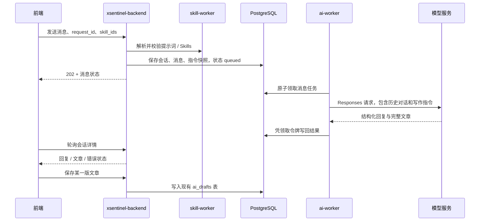

# 智能体对话：文章创作首版

入口为控制台「创作与发布 → 智能体对话」（`/agent-chat`）。支持持久化会话、生成文章、多轮修改，以及把某一版文章保存到文章管理。

## 使用

1. 在「数据源 → AI」配置支持 OpenAI Responses 协议的模型，并在 AI 创作设置中启用 AI。
2. 在「提示词管理」添加自定义提示词或导入 GitHub Skills。
3. 新建对话，输入主题、素材和要求。输入 `@` 或点击输入框下方的关联按钮，搜索并选择提示词和 Skills，候选项显示类型。使用方向键选择、Enter 确认、Esc 关闭；发送使用按钮或 Ctrl / Cmd + Enter。
4. 所选内容显示为可移除的标签，默认沿用到后续消息。每次发送时，后端重新校验有效性，并保存当时的名称、版本和完整指令快照；已发送的消息不随提示词编辑而改变。
5. 生成结束后继续描述修改要求。文章卡片提供「保存到文章管理」，同一条回复重复保存不会新增文章；保存不同回复会保留不同文章版本。

未选择提示词也可以对话。首版支持文字写作指导和导入 Skill 的已编译指令，不执行 Skill 脚本、不联网研究、不生成图片、不自动发布。

## 服务边界



后端是唯一的前端对话接口，负责鉴权、会话归属、提示词关联、任务提交、取消/重试和文章保存。`ai-worker` 负责读取 AI 数据源凭据、上下文拼装、模型通信及结果校验。

本版通过 PostgreSQL 持久化任务异步调用 `ai-worker`，沿用现有队列部署方式；没有新增 ai-worker 业务 HTTP 端口。`8202` 仍只提供监控指标。对话任务与已有 AI 生成任务共享单进程并发额度，避免两条队列分别放大模型并发。

后续可以让具体工具归属各业务微服务，以服务认证保护内部接口，由后端负责权限校验和编排。首版未实现模型工具调用循环，也不把文章保存交给模型自行决定。

## API 契约

以下路径均以 `/api/v1/agent-chat` 开头，并使用现有管理员登录鉴权；只有会话创建者可以读取或操作该会话。

| 方法 | 路径 | 用途 |
| --- | --- | --- |
| GET | `/conversations?page=1&page_size=30` | 分页读取自己的会话 |
| POST | `/conversations` | 创建会话 |
| GET | `/conversations/{id}` | 读取会话与消息状态 |
| POST | `/conversations/{id}/messages` | 提交消息，返回 202 |
| POST | `/conversations/{id}/messages/{turn_id}/cancel` | 取消排队或生成中的消息 |
| POST | `/conversations/{id}/messages/{turn_id}/retry` | 重试最后一条失败或取消的消息 |
| POST | `/conversations/{id}/messages/{turn_id}/article` | 保存文章，返回字符串类型的 `article_id` |

发送请求示例：

```json
{
  "request_id": "e150da15-3321-45bd-817e-daa4a7cae801",
  "content": "写一篇面向职场新人的 AI 工作指南，先列出大纲。",
  "skill_ids": [12, 34]
}
```

`skill_ids` 同时承载提示词与 Skills 的 ID，按选择顺序应用。后端从 skill-worker 获取指令，前端不能提交自定义 system 指令冒充已有资源。相同会话内重发同一 `request_id` 和相同内容会返回原消息；改变内容或关联项则返回 409。

模型 Responses 的 `output_text` 内容使用以下业务结构，通过 `AgentResult` 生成的严格 JSON Schema 约束。这两个字段是 Auto-X 的对话业务约定，不是 OpenAI 响应信封的顶层字段：

```json
{
  "reply": "已按照你的要求修改开头。",
  "article": {
    "title": "文章标题",
    "excerpt": "文章摘要",
    "content": "完整文章正文"
  }
}
```

澄清需求或纯讨论时 `article` 为 `null`。拒绝、不完整响应和无效 JSON 均作为失败处理，不保存半篇文章。界面以安全文本显示正文，不执行模型生成的 HTML。

## 可靠性与范围

- 每个会话同时只允许一条排队或运行中的消息，数据库部分唯一索引作最终保护。
- Worker 原子领取任务，以领取令牌和租约限制结果写回；取消或租约过期后的旧结果无法覆盖重试结果。取消是逻辑取消，已经发到模型服务的请求可能仍会消耗额度。
- Worker 退出会把尚未完成的任务重新排队；异常退出留下的运行任务在租约过期后标记失败，可手动重试。模型服务请求不承诺恰好一次计费。
- 重试保留原消息的提示词 / Skill 快照，采用当前生成长度、超时等设置，以及执行时的 AI 数据源配置。
- 每条用户消息最多 20,000 字符，每次最多关联 20 项，关联指令总量最多 160,000 字符；每个会话最多 100 条用户消息。
- 模型上下文包含最近至多 12 轮成功对话，按 120,000 字符预算保留完整轮次；必要时额外附加最近一版文章，避免长时间讨论后丢失编辑对象。更早的讨论仍保存在界面，但不保证进入模型上下文。
- 前端每 2 秒查询运行中会话；首版不是逐字流式输出。
- 会话按创建者隔离。保存到文章管理后，沿用现有文章管理的管理员访问规则。

## 升级

新增 Alembic 迁移 `0040_agent_chat`，创建 `agent_conversations` 与 `agent_turns`。按当前环境的升级流程先运行迁移，再更新 `backend`、`ai-worker` 与 `frontend`。不需要新增服务、端口或环境变量；skill-worker 继续提供现有解析接口。

本地开发环境的迁移命令（在 `backend/` 中，使用该环境的数据库配置）：

```bash
alembic upgrade head
```

不要只更新前端：未迁移或未更新的 worker 无法处理新对话任务。

实现入口：`backend/app/api/routes/agent_chat.py`、`backend/app/services/agent_chat_worker.py`、`backend/app/services/agent_provider.py`、`frontend/src/views/AgentChatView.vue`。
