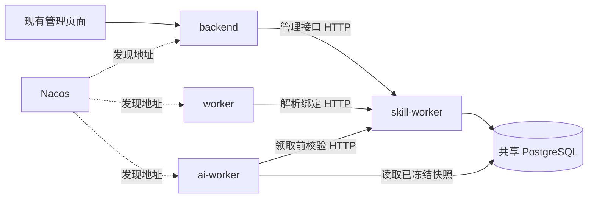

# Skill Worker

`skill-worker` 承接现有 Skill 管理、绑定、解析和校验，默认 HTTP 端口 `8204`，Nacos 服务名 `xsentinel-skill-worker`。它复用 core 后端镜像，入口为 `uvicorn app.skill_worker:app --host 0.0.0.0 --port 8204`。

## 边界与兼容性



页面继续调用原来的 `/api/v1/ai/settings`、`/ai/skills`、`/ai/features`、账号 Skill 绑定和 `/ai/listen-tasks` 接口。backend 使用明确路由清单转发；路径、请求模型、状态码和响应模型保持一致。生成任务、草稿、模型调用和发布调度仍由原服务负责。

监听任务的配置、暂停/恢复/归档、队列决策与补生成请求一起移到 skill-worker：这些操作会同时修改绑定、配置版本、任务状态及审计事件，需要保留同一个数据库事务。历史扫描与执行仍在 ai-worker。

保留的行为：

- 选择优先级：显式覆盖（包括空列表）→ 账号与功能点绑定 → 全局默认；绑定顺序保持不变。
- 任务入队时冻结 Skill 内容、版本和选择来源；后续修改或切换不改写已有任务快照。
- 历史补生成使用提交时的快照，领取和继续扫描时仍校验当前任务绑定。
- 删除仍是停用：同一事务内移除全局默认、禁用账号绑定，并将关联任务队列标为 `skill_invalidated`。
- 暂停、配置版本冲突、保留旧队列的决策和重试次数沿用现有规则。
- HTTP、Nacos 或认证故障返回 `503 skill_service_unavailable`。轮询入队事务回滚，补生成游标不前移，领取失败不消耗模型尝试次数；不会把服务故障当成空绑定或 Skill 已失效。

管理页面现已独立为 `/skills`。GitHub 导入与磁盘持久化见下节；执行范围为写作指令与参考文本。

## 自定义与 GitHub Skills

两种来源共用 `ai_skills.id`，因此账号绑定、全局默认、监听任务和内容流的手动生成可以混合选择。自定义 Skill 的指令保存在数据库；GitHub Skill 在数据库中保存索引、来源、固定 Commit、版本、编译指令缓存与文件校验信息，完整原始目录保存在 skill-worker 的磁盘中。

在 **Skills管理 → 从 GitHub 导入** 粘贴公开仓库或 `tree` 目录地址。例如：

```text
https://github.com/SpaceZephyr/creator-buddy/tree/main/xhs-Skills
```

根仓库地址默认使用其默认分支；也可填写分支、标签或 Commit 和子目录。分支名含 `/` 时，推荐使用仓库根地址并单独填写分支和目录。暂不支持私有仓库认证。目录内每个 `SKILL.md` 注册为一个 Skill，名称与说明取 YAML frontmatter；没有 frontmatter 时使用目录名。

- 完整保存所选目录内的文件，包括脚本、图片与其他资源。脚本不执行、依赖不安装、外部工具不调用。
- 文章生成使用 `SKILL.md` 正文、Skill 内 `references/` 下的 UTF-8 文本，以及 Markdown 链接或反引号路径引用的本地文本（可递归读取，且必须处于此次导入范围内）。支持 `.md/.txt/.json/.yaml/.yml/.csv`；不自动执行其他 Skill 的路由或工具调用。
- 每个 Skill 的写作上下文最多 100000 字符；超出上限或缺少的引用会在导入结果与详情中提示，已下载的原文件仍完整保留。生图、实时搜索等 Skill 仅能提供写作指导，无法在本阶段完成对应工具动作。
- 同一仓库路径重复导入保持原 ID；相同分支、导入范围、Commit 与指令内容为无变化，变化时递增 Skill 版本。扩大导入目录时会保留新增范围的全部文件，切换分支时会更新后续导入来源。停用状态保持，导入不会重新启用已停用项。名称冲突会加来源摘要后缀，避免覆盖自定义 Skill。
- GitHub Skill 只允许在页面切换启停，正文通过重新导入更新。更新使用原导入范围，可能同时更新该目录中的其他 Skills。删除沿用停用语义，文件和历史快照保留。

### 持久化目录与升级

Compose 默认绑定 `${SKILL_STORAGE_HOST_DIR:-./data/skills}` 到容器 `/var/lib/xsentinel/skills`。现有服务器安装路径为 `/home/docker/auto-x`，因此实际宿主机目录是 **`/home/docker/auto-x/data/skills`**，在当前拓扑中位于 **hn-1**。`skill-storage-init` 首先赋予 UID/GID `10001:10001` 写权限；只有 skill-worker 挂载此目录，ai-worker 通过 HTTP 取内容。安装器直接继承基础 Compose 的挂载与初始化依赖。

```text
data/skills/bundles/<不可变包ID>/
  repo/<仓库内路径>/...    # 原始完整目录
  prompts/<来源摘要>.md  # 解析后的写作指令及参考文本
  manifest.json           # 原文件大小与 SHA-256
```

新增迁移 `0037_github_skills`：升级前备份 PostgreSQL；执行 `alembic upgrade head`，先升级 skill-worker，再升级 backend / ai-worker，最后更新 frontend。更新与备份必须同时保留数据库和 `data/skills`。部署多实例时必须共享同一持久化目录；独立本机磁盘不能被多个 Nacos 实例交替使用。恢复时按原包 ID 恢复整个目录，不能仅重新导入当前分支替代旧版本。无法确认数据库提交结果时保留目录，可能留下孤立包；暂不自动清理旧包，避免影响历史任务。

原生 `start.sh` 使用项目根目录 `data/skills`，可用 `SKILL_STORAGE_DIR` 覆盖；该路径属于节点本地配置，不接受 Nacos 共享配置覆盖。容器路径固定，宿主机路径通过 `SKILL_STORAGE_HOST_DIR` 配置。skill-worker 内存上限调整为 512 MiB，以容纳受限的归档处理。

### HTTP 与任务快照

`POST /api/v1/ai/skills/import-github` 由 backend 转发到 skill-worker，沿用管理员身份和 `skills:manage` 权限。下载固定 Commit 归档，验证目录、文件大小及普通文件类型，先原子落盘，再在设置锁保护下提交索引。每实例串行导入；下载不占有设置锁。失败不提交部分 Skill。

导入的整体 HTTP 超时默认 180 秒（`SKILL_IMPORT_TIMEOUT_SECONDS`），前端及 nginx 默认为 190 秒。若自行加长服务超时，应同步修改前端及反向代理；已有外层网关也需允许该时长。GitHub 下载总计最多 120 秒；限制为压缩包 32 MiB、所选目录 2000 文件 / 96 MiB、单文件 16 MiB、每次最多 50 个 Skills。超时后先刷新列表确认结果；重复导入同一版本不会重复创建记录。

入队仍通过原内部解析接口获取有序 Skill 并冻结内容与来源版本。AI Worker 在领取有 Skill 的作业、消耗尝试次数之前，通过 Nacos 调用 **`GET /v1/jobs/{job_id}/skills`**（`skills:read`）：自定义 Skill 返回该作业冻结的指令；GitHub Skill 读取该作业固定包的磁盘文件并校验 SHA-256，再与冻结快照核对。更新当前 Skill 不改写排队任务。磁盘文件缺失、被改动或 HTTP 故障时保持队列，不消耗模型尝试次数。

`/ai-writing` 的监听任务与默认 Skills、`/tweets` 的 AI 生成选择框都同时展示两种来源。默认优先级、显式空选择、绑定顺序、任务切换、补生成和旧队列规则继续沿用。

## 文件对应

| 文件 | 职责 |
| --- | --- |
| `backend/app/skill_worker.py` | 服务生命周期、Nacos 注册、鉴权、内部解析 API、健康检查与指标 |
| `backend/app/skills/routes.py` | 设置、Skill CRUD、功能点、账号绑定的原管理逻辑 |
| `backend/app/skills/listening_routes.py` | 监听任务管理及原子配置操作 |
| `backend/app/skills/listening.py` | 本地校验、预览、统计与输出 |
| `backend/app/skills/backfill.py` | 创建补生成请求和冻结配置快照 |
| `backend/app/skills/store.py` | 服务内部的 Skill 查询及选择优先级 |
| `backend/app/skills/packages.py` | GitHub 下载、归档校验、完整落盘、写作指令编译和版本校验 |
| `backend/app/schemas/skill_import.py` | GitHub 导入请求与响应协议 |
| `backend/app/skills/bootstrap.py` | 内置 Skill 的幂等初始化 |
| `backend/app/api/skill_proxy.py` | 保留原页面 API 的 HTTP 转发层 |
| `backend/app/services/skill_client.py` | Nacos 发现、服务 Token、HTTP、超时和响应校验 |
| `backend/app/schemas/skill_service.py` | 内部 HTTP 请求与响应协议 |
| `backend/app/services/ai_jobs.py` | 通过 HTTP 解析 Skill，然后冻结快照、入队 |
| `backend/app/services/ai_listen_backfill.py` | 原 AI Worker 历史扫描与游标逻辑 |

## 内部 HTTP 与认证

| 接口 | 用途 | 权限 |
| --- | --- | --- |
| `POST /v1/skills/resolve` | 按给定 ID 顺序返回仍有效的 Skill | `skills:read` |
| `POST /v1/skills/context` | 解析显式覆盖、账号绑定和默认选择 | `skills:read` |
| `GET /v1/tasks/{task_id}/skills` | 返回监听任务绑定顺序及有效 Skill | `skills:read` |
| `GET /v1/jobs/{job_id}/skills` | 读取任务冻结的自定义指令或磁盘 Skill 版本 | `skills:read` |
| `/ai/...` 的管理路由 | 原有管理能力 | `skills:manage`，同时验证原管理员 Token |
| `GET /health/live`、`GET /health/ready` | 进程及数据库健康 | 健康检查 |
| `GET /metrics` | Prometheus | 指标采集 |

服务 Token audience 为 `skill-worker`。backend 使用 `skill-backend`，具备读取和管理权限；轮询使用 `skill-poller`，AI Worker 使用 `skill-ai-worker`，两者只有读取权限。管理转发使用 `X-User-Authorization` 携带原用户 Token，skill-worker 再验证签名、会话是否撤销、管理员是否有效和任务归属。

`microservices-init.sh` 与 `nacos-config.py` 会创建缺少的新身份并同步专用 `.secret` 文件；auth-center 在启动时将新增身份导入 PostgreSQL。现有身份、密钥和后续撤销的授权不被覆盖。升级时需要让 auth-center 重新加载更新后的 `clients.json`。

## 事务约束

本阶段继续共享 PostgreSQL，属于进程和职责拆分。消费者在入队、领取和扫描时按 **AISetting → 监听任务 → 作业** 的顺序持锁；skill-worker 的配置修改也先锁 AISetting。内部解析接口只读已提交数据，不获取这些排他锁，避免调用方等待 HTTP、服务端又等待调用方锁的死锁。

这依赖所有写入方使用上述锁协议，以及所有实例连接同一主数据库。不能把解析服务指向有复制延迟的只读库。后续如果拆数据库，需要另行设计版本校验与事件一致性，不能直接复用当前事务保证。

Skill 的 ORM 关系改为显式加载：消费者加载监听任务时不再隐式查询 Skill 表，服务端管理操作按需加载。HTTP 客户端不提供本地 SQL 回退，也不自动重试管理写请求；写入超时后应重新读取状态，避免重复创建。

`SKILL_REQUEST_TIMEOUT_SECONDS` 默认 10 秒，覆盖发现、取 Token 和 HTTP 请求；连接和 Token 缓存随进程生命周期复用。服务端数据库连接池独立于调用方连接池。

## 部署与升级

最初的服务拆分无新增数据库迁移，现有数据继续使用；后续 GitHub 能力须先运行上述 `0037` 迁移。原服务拆分的部署顺序记录如下：

1. 备份当前 Nacos 共享配置、监控拓扑和节点映射，以及 PostgreSQL 的认证身份与授权。先让所有节点的 `monitor-center`、`monitor-agent` 使用支持 `skill_worker` 组件的新镜像；此阶段保留原监控拓扑，不运行会同步新拓扑的安装器流程。旧版监控服务无法解析该组件，提前发布会使旧实例在重启时失败。确认每个监控实例升级完成后再继续。
2. 暂停自动采集和 AI 消费。同步 Nacos 的 Skill 服务配置、三个调用方身份及专用 `.secret` 文件；此时再将新服务加入实际部署节点的监控拓扑，并配置 Nacos 注册地址和端口。
3. 将更新后的 `clients.json` 同步到全部认证中心节点，升级或重启 `auth-center` 导入新增身份。实际验证 `skill-backend`、`skill-poller`、`skill-ai-worker` 均能取得 audience 为 `skill-worker` 的 Token，再部署 `skill-worker`。
4. 检查 Skill 服务数据库就绪、Nacos 实例注册和带 Token 的解析接口；随后升级 `backend`、`worker`、`ai-worker`，验证原管理接口转发、任务入队和领取后恢复采集与消费。健康检查只验证数据库可达，不能代替认证和解析接口验收。

各节点必须连接同一 PostgreSQL 主库。不要在升级窗口混用新旧配置写入路径；采用固定的 `sha-<commit>` 镜像标签，保留升级前的镜像和配置备份供回退。

单机 Compose：

```bash
./infra/scripts/microservices-init.sh
docker compose up -d --build auth-center skill-worker backend worker ai-worker
```

`make up`、`make prod-up`、`make external-up` 已包含凭据初始化和新服务。直接运行 Compose 前也要执行初始化脚本。已有集群通过 Nacos 同步配置时，以远端身份和密钥为准。

分布式部署叠加 `docker-compose.skill-worker.yml`；轮询节点叠加 `docker-compose.worker.yml`，其他节点沿用各自组件文件。配置 Nacos 可达地址和 `NACOS_ADVERTISE_IP`，注册端口由 `SKILL_WORKER_HOST_PORT` 指定。配置 Nacos 后只走发现结果，发现失败不回退固定 URL。无 Nacos 的本地模式使用 `SKILL_SERVICE_URL`，Compose 默认 `http://skill-worker:8204`，原生开发默认 `http://127.0.0.1:8204`。

原生管理台 `./start.sh` 会同时启动 skill-worker，`./stop.sh` 会一并停止。单独启动消费者时，分别配置 `SKILL_CLIENT_ID` 和 `SKILL_CLIENT_SECRET_FILE`：轮询用 `skill-poller.secret`，AI Worker 用 `skill-ai-worker.secret`。

kejilion 安装器支持选择 `skill-worker`；安装 backend/frontend 时默认加入同机 skill-worker。已有远端服务时设置 `KJ_AUTO_X_SKILL_REMOTE=1`，由 Nacos 发现。监控拓扑会在选择部署新服务的节点添加对应项。

## 验证

```bash
cd backend
pytest tests/test_skill_service.py tests/test_ai_listen_tasks.py tests/test_ai_listen_pipeline.py
TEST_POSTGRES_DSN=postgresql+asyncpg://postgres@127.0.0.1:5432/postgres \
  pytest tests/test_postgres_integration.py
```

HTTP 测试覆盖实际 FastAPI 转发、JWT/会话校验、权限隔离、优先级、任务切换、快照、停用级联及故障回滚。PostgreSQL 测试使用独立 schema，验证持锁期间的 HTTP 读取、写入等待、并发初始化及迁移/模型两种建库路径。

## 2026-10-20 部署记录

运行版本为 `7030dad03b151ceb6bc742fb2f6efad94f63bae8`，已发布到 Auto-X `dev/main`；安装器为 apps/stanxu `0b5c144`。[Actions 39369475546](https://github.com/StanXu-symple/auto-x/actions/runs/39369475546) 成功，使用固定标签 `sha-7030dad03b151ceb6bc742fb2f6efad94f63bae8`，后端镜像 digest 为 `sha256:ffe40dfc17d09409701220d2dd1194e8c56d2481f8a7cc308ed239a313b2cdc9`。

| 节点 | 本次变更 | 最终服务清单 |
| --- | --- | --- |
| hn-1 | 新增 skill-worker；升级 monitor-center、monitor-agent | xhs-worker,camoufox-worker,monitor-center,monitor-agent,skill-worker |
| tc-2 | 升级 auth-center、backend、worker、ai-worker、monitor-agent | backend,worker,ai-worker,qq-worker,auth-center,monitor-agent,frontend |

部署使用已发布安装器的 `auto_x_prepare_control_plane_bootstrap`、`auto_x_sync_nacos_config`、`auto_x_prepare_compose_override` 和 `auto_x_compose` 函数分阶段执行。先让两节点全部监控服务兼容新组件，再同步凭据/拓扑、重建认证中心、运行现有 Alembic 头校验并启动 hn-1 Skill；从 tc-2 验证三个身份的跨节点解析均为 200 后，切换原调用方。数据库仍为 `0036_browser_job_results`。

本次未重建 hn-1 的 xhs-worker/camoufox-worker，也未重建 tc-2 的 frontend、qq-worker、PostgreSQL、Redis；这些容器 ID 与部署前一致。后续更新 tc-2 时须带 `KJ_AUTO_X_SKILL_REMOTE=1 KJ_AUTO_X_CAMOUFOX_REMOTE=1`，让它继续使用 hn-1 的两个远端服务，避免安装器自动加入本机副本。hn-1 的 Camoufox 与 tc-2 的 frontend 继续固定原标签。

验收结果：

- Nacos 只有一个健康的 `xsentinel-skill-worker` 实例，属于 hn-1，端口 8204；三个专用身份的 Token 签名、scope 和真实 HTTP 解析通过。worker/ai-worker 容器各自使用实际挂载的凭据解析成功。
- 使用现有管理员配置正常登录，公开 `/api/v1/ai/skills`、`/ai/features`、`/ai/settings`、`/ai/listen-tasks` 均为 200，响应与 Skill 服务直连相同；验证会话随后注销。生产环境没有执行 Skill 管理写操作来制造测试数据。
- 从更新前的 PostgreSQL dump 仅读取 COPY 数据生成哈希，再对现库执行只读比对：4 个 Skill、1 个功能点、1 份设置、1 个监听任务、3 条任务 Skill 绑定、1 条订阅、34 个历史生成任务的 Skill/任务/请求快照均一致；账号绑定和补生成表原本为空，仍为空。
- 监控包含原 13 项加 hn1-skill-worker，共 14 个健康实例、2 个健康节点；frontend/backend 健康检查均为 200。新版本业务进程检查时没有 ERROR/CRITICAL 日志。
- 原有共享配置值、认证客户端及授权、监控记录和节点映射保持；只新增三个 Skill 客户端及新服务配置/拓扑记录。

服务器本地备份（权限受限，不导出到开发机）：

- hn-1：`/home/docker/auto-x/backups/pre-skill-worker-20261020T042641Z`
- tc-2：`/home/docker/auto-x/backups/pre-skill-worker-20261020T042654Z`

备份包含原环境、完整服务清单、Compose/控制面文件、容器版本、三个 Nacos 文档及媒体卷；tc-2 另有 PostgreSQL 自定义格式 dump 与 Redis RDB。`sha256.json` 保存完整性清单，`deployment-verification.json` 保存配置/容器比对结果，tc-2 的 `skill-invariants-after.json` 保存数据哈希比对。回滚时以这些原始版本和配置为准，先停止新消费者，再恢复原服务及配置；保留现有数据库和业务卷，不能用 `down --volumes` 替代回滚。
