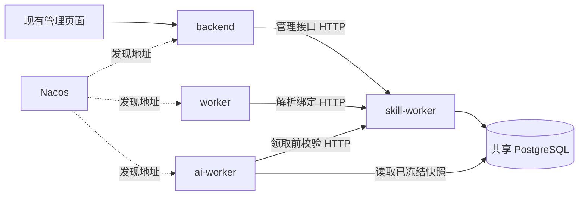

# Skill Worker

`skill-worker` 承接现有 Skill 管理、绑定、解析和校验，默认 HTTP 端口 `8204`，Nacos 服务名 `xsentinel-skill-worker`。它复用 core 后端镜像，入口为 `uvicorn app.skill_worker:app --host 0.0.0.0 --port 8204`。

## 边界与兼容性



页面继续调用原来的 `/api/v1/ai/settings`、`/ai/skills`、`/ai/features`、账号 Skill 绑定和 `/ai/listen-tasks` 接口。backend 使用明确路由清单转发；路径、请求模型、状态码和响应模型保持一致。生成任务、草稿、模型调用和发布调度仍由原服务负责。

监听任务的配置、暂停/恢复/归档、队列决策与补生成请求一起移到 skill-worker：这些操作会同时修改绑定、配置版本、任务状态及审计事件，需要保留同一个数据库事务。历史扫描与执行仍在 ai-worker。

保留的行为：

- 选择优先级：显式覆盖（包括空列表）→ 账号与功能点绑定 → 全局默认；绑定顺序保持不变。
- 任务入队时冻结 Skill 内容、版本和选择来源；后续修改或切换不改写已有任务快照。
- 历史补生成使用提交时的快照，领取和继续扫描时仍校验当前任务绑定。
- 删除仍是停用：同一事务内移除全局默认、禁用账号绑定，并将关联任务队列标为 `skill_invalidated`。
- 暂停、配置版本冲突、保留旧队列的决策和重试次数沿用现有规则。
- HTTP、Nacos 或认证故障返回 `503 skill_service_unavailable`。轮询入队事务回滚，补生成游标不前移，领取失败不消耗模型尝试次数；不会把服务故障当成空绑定或 Skill 已失效。

本次没有引入 Skill 下载、脚本执行沙箱、Skill 市场或新的页面入口。

## 文件对应

| 文件 | 职责 |
| --- | --- |
| `backend/app/skill_worker.py` | 服务生命周期、Nacos 注册、鉴权、内部解析 API、健康检查与指标 |
| `backend/app/skills/routes.py` | 设置、Skill CRUD、功能点、账号绑定的原管理逻辑 |
| `backend/app/skills/listening_routes.py` | 监听任务管理及原子配置操作 |
| `backend/app/skills/listening.py` | 本地校验、预览、统计与输出 |
| `backend/app/skills/backfill.py` | 创建补生成请求和冻结配置快照 |
| `backend/app/skills/store.py` | 服务内部的 Skill 查询及选择优先级 |
| `backend/app/skills/bootstrap.py` | 内置 Skill 的幂等初始化 |
| `backend/app/api/skill_proxy.py` | 保留原页面 API 的 HTTP 转发层 |
| `backend/app/services/skill_client.py` | Nacos 发现、服务 Token、HTTP、超时和响应校验 |
| `backend/app/schemas/skill_service.py` | 内部 HTTP 请求与响应协议 |
| `backend/app/services/ai_jobs.py` | 通过 HTTP 解析 Skill，然后冻结快照、入队 |
| `backend/app/services/ai_listen_backfill.py` | 原 AI Worker 历史扫描与游标逻辑 |

## 内部 HTTP 与认证

| 接口 | 用途 | 权限 |
| --- | --- | --- |
| `POST /v1/skills/resolve` | 按给定 ID 顺序返回仍有效的 Skill | `skills:read` |
| `POST /v1/skills/context` | 解析显式覆盖、账号绑定和默认选择 | `skills:read` |
| `GET /v1/tasks/{task_id}/skills` | 返回监听任务绑定顺序及有效 Skill | `skills:read` |
| `/ai/...` 的管理路由 | 原有管理能力 | `skills:manage`，同时验证原管理员 Token |
| `GET /health/live`、`GET /health/ready` | 进程及数据库健康 | 健康检查 |
| `GET /metrics` | Prometheus | 指标采集 |

服务 Token audience 为 `skill-worker`。backend 使用 `skill-backend`，具备读取和管理权限；轮询使用 `skill-poller`，AI Worker 使用 `skill-ai-worker`，两者只有读取权限。管理转发使用 `X-User-Authorization` 携带原用户 Token，skill-worker 再验证签名、会话是否撤销、管理员是否有效和任务归属。

`microservices-init.sh` 与 `nacos-config.py` 会创建缺少的新身份并同步专用 `.secret` 文件；auth-center 在启动时将新增身份导入 PostgreSQL。现有身份、密钥和后续撤销的授权不被覆盖。升级时需要让 auth-center 重新加载更新后的 `clients.json`。

## 事务约束

本阶段继续共享 PostgreSQL，属于进程和职责拆分。消费者在入队、领取和扫描时按 **AISetting → 监听任务 → 作业** 的顺序持锁；skill-worker 的配置修改也先锁 AISetting。内部解析接口只读已提交数据，不获取这些排他锁，避免调用方等待 HTTP、服务端又等待调用方锁的死锁。

这依赖所有写入方使用上述锁协议，以及所有实例连接同一主数据库。不能把解析服务指向有复制延迟的只读库。后续如果拆数据库，需要另行设计版本校验与事件一致性，不能直接复用当前事务保证。

Skill 的 ORM 关系改为显式加载：消费者加载监听任务时不再隐式查询 Skill 表，服务端管理操作按需加载。HTTP 客户端不提供本地 SQL 回退，也不自动重试管理写请求；写入超时后应重新读取状态，避免重复创建。

`SKILL_REQUEST_TIMEOUT_SECONDS` 默认 10 秒，覆盖发现、取 Token 和 HTTP 请求；连接和 Token 缓存随进程生命周期复用。服务端数据库连接池独立于调用方连接池。

## 部署与升级

无新增数据库迁移，现有数据继续使用。已有分布式集群按以下顺序升级：

1. 备份当前 Nacos 共享配置、监控拓扑和节点映射，以及 PostgreSQL 的认证身份与授权。先让所有节点的 `monitor-center`、`monitor-agent` 使用支持 `skill_worker` 组件的新镜像；此阶段保留原监控拓扑，不运行会同步新拓扑的安装器流程。旧版监控服务无法解析该组件，提前发布会使旧实例在重启时失败。确认每个监控实例升级完成后再继续。
2. 暂停自动采集和 AI 消费。同步 Nacos 的 Skill 服务配置、三个调用方身份及专用 `.secret` 文件；此时再将新服务加入实际部署节点的监控拓扑，并配置 Nacos 注册地址和端口。
3. 将更新后的 `clients.json` 同步到全部认证中心节点，升级或重启 `auth-center` 导入新增身份。实际验证 `skill-backend`、`skill-poller`、`skill-ai-worker` 均能取得 audience 为 `skill-worker` 的 Token，再部署 `skill-worker`。
4. 检查 Skill 服务数据库就绪、Nacos 实例注册和带 Token 的解析接口；随后升级 `backend`、`worker`、`ai-worker`，验证原管理接口转发、任务入队和领取后恢复采集与消费。健康检查只验证数据库可达，不能代替认证和解析接口验收。

各节点必须连接同一 PostgreSQL 主库。不要在升级窗口混用新旧配置写入路径；采用固定的 `sha-<commit>` 镜像标签，保留升级前的镜像和配置备份供回退。

单机 Compose：

```bash
./infra/scripts/microservices-init.sh
docker compose up -d --build auth-center skill-worker backend worker ai-worker
```

`make up`、`make prod-up`、`make external-up` 已包含凭据初始化和新服务。直接运行 Compose 前也要执行初始化脚本。已有集群通过 Nacos 同步配置时，以远端身份和密钥为准。

分布式部署叠加 `docker-compose.skill-worker.yml`；轮询节点叠加 `docker-compose.worker.yml`，其他节点沿用各自组件文件。配置 Nacos 可达地址和 `NACOS_ADVERTISE_IP`，注册端口由 `SKILL_WORKER_HOST_PORT` 指定。配置 Nacos 后只走发现结果，发现失败不回退固定 URL。无 Nacos 的本地模式使用 `SKILL_SERVICE_URL`，Compose 默认 `http://skill-worker:8204`，原生开发默认 `http://127.0.0.1:8204`。

原生管理台 `./start.sh` 会同时启动 skill-worker，`./stop.sh` 会一并停止。单独启动消费者时，分别配置 `SKILL_CLIENT_ID` 和 `SKILL_CLIENT_SECRET_FILE`：轮询用 `skill-poller.secret`，AI Worker 用 `skill-ai-worker.secret`。

kejilion 安装器支持选择 `skill-worker`；安装 backend/frontend 时默认加入同机 skill-worker。已有远端服务时设置 `KJ_AUTO_X_SKILL_REMOTE=1`，由 Nacos 发现。监控拓扑会在选择部署新服务的节点添加对应项。

## 验证

```bash
cd backend
pytest tests/test_skill_service.py tests/test_ai_listen_tasks.py tests/test_ai_listen_pipeline.py
TEST_POSTGRES_DSN=postgresql+asyncpg://postgres@127.0.0.1:5432/postgres \
  pytest tests/test_postgres_integration.py
```

HTTP 测试覆盖实际 FastAPI 转发、JWT/会话校验、权限隔离、优先级、任务切换、快照、停用级联及故障回滚。PostgreSQL 测试使用独立 schema，验证持锁期间的 HTTP 读取、写入等待、并发初始化及迁移/模型两种建库路径。
