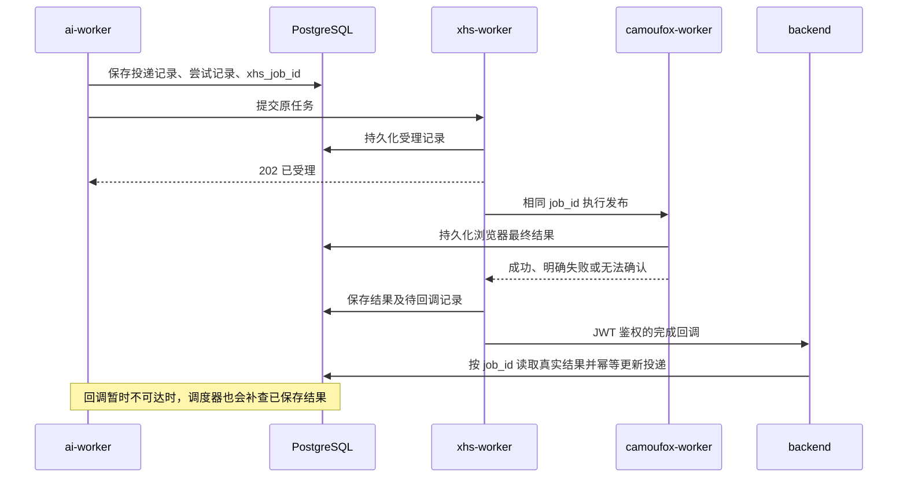

# 小红书自动发布结果回传

## 本次解决的问题

以前自动发布把“HTTP 等待失败”和“平台发布失败”混在一起：`AIPublishDispatcher` 的请求一旦超时就记为“结果待核对”，之后没有小红书结果补查。浏览器同步线程即使在超时之后发布成功，浏览器池也会丢弃这个迟到结果。

现在自动任务以固定 `xhs_job_id` 贯穿 ai-worker、xhs-worker 和 camoufox-worker。浏览器同步线程执行完后保留真实结果，Worker 先保存到 PostgreSQL，再发送完成回调。HTTP 202 只代表受理，不会直接标记“已推送”。手动发布继续使用原来的同步等待接口。

## 用户看到的状态

| 状态 | 含义与处理 |
| --- | --- |
| 推送中 | Worker 已受理，浏览器执行中。 |
| 自动确认结果中 | 连接中断或等待超时，系统正在查询同一个任务；不会重复发布。 |
| 已推送 | 浏览器确认平台发布成功，自动更新投递及发布历史。取得有效公开笔记链接时显示“查看笔记”。 |
| 推送失败 | 未点击发布前失败，或平台明确拒绝，例如上传失败、输入校验失败、未完成安全验证。保留具体原因；可显式重试。 |
| 结果待核对 | 发布动作可能已经发生，但浏览器/进程崩溃等原因使平台结果无法确定。保留防重复发布保护；系统仍查询原记录，后来取得明确结果会自动修正。 |

“执行报错”不等于“平台肯定未发布”。点击发布之后的网络中断不能安全地强行归类为失败，否则重新发送可能重复发笔记。此状态只保留给确实无法证明的异常；普通完成结果和迟到的成功不再依赖人工确认。小红书要求真人扫码时，仍需要完成平台验证，回调机制不能代替扫码。

## 持久化、补查和鉴权

- 新表 `browser_job_results`：按 `namespace + job_id` 分别保存两层 Worker 的受理和最终结果、租约、补查时间、回调次数/下次时间/送达时间。不保存 Cookie、文章正文或上传图片路径，只保存请求指纹和脱敏后的结果。
- `ai_publish_dispatches.xhs_job_id` 在发送请求前写入；重复提交同一 ID 不再次运行，重复或迟到回调不会覆盖新尝试或人工核对结论。
- XHS 每 5 秒运行补查与回调循环；每条补查记录间隔至少 30 秒，支持多实例公平领取。回调失败按指数间隔重试，最大间隔 300 秒。
- ai-worker 扫描时每条待完成投递约 10 秒补查一次数据库结果，作为回调丢失的补偿。补查只查询原任务，绝不重新提交发布。
- Redis 用于活动任务锁和短期缓存。结果超出 Redis TTL 后仍能从 PostgreSQL 查到。
- 回调地址固定为 backend 的 `/api/v1/internal/xhs/jobs/{job_id}/completion`（API 前缀可配置）。通过 Nacos 的 `XHS_RESULT_SERVICE_NAME` 查找 backend，默认 `xsentinel-backend`；没有节点 IP 或任意回调 URL。
- 使用 `xhs-worker` 身份、`backend` audience、`xhs:result` scope。接收端另外校验发送者，并从数据库读取真实结果；请求正文不能把失败伪造为成功。
- 旧版 Worker 的笼统 `failed` 响应不含 `failure_confirmed`，按无法确认处理，避免滚动更新期间错误开放重试。

## 升级要求

需升级 **auth-center、backend、ai-worker、xhs-worker、camoufox-worker、frontend**，并执行数据库迁移 **`0036_browser_job_results`**。Camoufox 的 2 GB 内存限制、已有浏览器资料和 Nacos 服务发现方式保持现有配置。

正式发布仍按项目的《Auto-X一键更新傻瓜式文档》执行：dev 合并 main，等待 Actions 镜像就绪，通过 `bash kejilion.sh app auto-x` 菜单 2 更新。

1. 升级窗口暂停监听自动推送并等待正在运行的发布结束，备份数据库及浏览器资料。
2. 先用安装器完成迁移，升级 auth-center、backend，使回调接收端及服务授权可用。
3. 更新所有 camoufox-worker 实例，再更新 xhs-worker，最后更新 ai-worker、frontend；全部就绪后恢复监听，避免新调度器提交给仍只保存短期 Redis 结果的旧 XHS Worker。
4. 安装器会向 Nacos 补齐缺失的 `XHS_RESULT_SERVICE_NAME`，已有自定义值保留。xhs-worker 节点需要能访问 Nacos 注册的 backend 地址/端口；两个 Worker 需要访问共享 PostgreSQL。
5. 安装器选择 `ai-worker` 必须同时加载 `docker-compose.ai-worker.yml`：从微服务覆盖继承 `XHS_TRANSPORT=http`、独立服务凭据只读挂载和 control 网络。仅检查镜像版本、容器 healthy 或 backend 的客户端不能证明 AI 发布通道正确；必须在 ai-worker 进程内检查实际配置和鉴权状态。
6. 认证中心的授权补齐只执行一次；既有自定义授权、禁用状态和后续撤销不会被覆盖。详见《Camoufox Worker》中的回调授权说明。

升级前的历史“结果待核对”记录没有稳定 `xhs_job_id`，无法自动关联已经过期的浏览器任务，不会被猜测为成功或自动重发。验收应使用用户新发起的一条自动投递，检查相同任务 ID 的两层结果、回调送达时间与文章状态；不要为验证回调直接重新发布历史不确定记录。

## 2026-10-18 部署记录

运行提交 `a337766d3fd9cf8b27fdb54bd472fd1ffe455ae4` 已发布 dev/main，Actions 全部成功，通过安装器菜单 2 分阶段更新 tc-2 和 hn-1，数据库迁移到 `0036_browser_job_results`。六个目标服务健康、Nacos 回调发现和 JWT 鉴权检查通过，已有配置及浏览器资料保留。实际步骤、备份位置和验收边界见[更新文档第三十一节](Auto-X一键更新傻瓜式文档.md#三十一小红书自动发布持久结果与完成回调升级)。本次没有发起真实小红书发布；新自动投递的最终业务结果仍须结合实际任务记录观察。

## 2026-10-19 自动发布仍待核对的原因

2026-10-18 部署的镜像包含新逻辑，但安装器此前将 `ai-worker` 视为基础 Compose 服务，未加载它在 `docker-compose.microservices.yml` 中的覆盖。实际 `xhs_transport=redis`，独立 `ai-worker.secret` 未挂载；手动发布的 backend 则已正确使用 HTTP。因此 AI 自动投递没有稳定 `xhs_job_id`，进入没有消费者的旧队列，约 305 秒后显示笼统待核对，两层持久结果表为空。当前问题不能归因于小红书浏览器发布后未能判断结果，因为这些请求没有进入新 HTTP 发布链路。

安装器现按选择加载新的 AI 专用 Compose 片段，并初始化所需网络。应用参数仍从 Nacos 读取；HTTP 通道及密钥挂载属于部署结构。升级后必须从真实 ai-worker 客户端验证 Nacos 发现及认证。旧 Redis 队列和历史待核对记录先备份保留，不启动旧消费者、不自动重新发布，避免与人工已发笔记重复。修复步骤与实际验收见更新文档第三十二节。

本次修复已发布并于 2026-10-19 通过菜单 2 在 tc-2 生效：ai-worker 实际 HTTP 通道、独立凭据挂载、Nacos 发现及真实服务身份的只读状态调用均通过。hn-1 未更新，历史队列未重放。后续自然自动投递的最终结果仍需按同一 `xhs_job_id` 观察，详见更新文档第三十二节实际部署结果。
